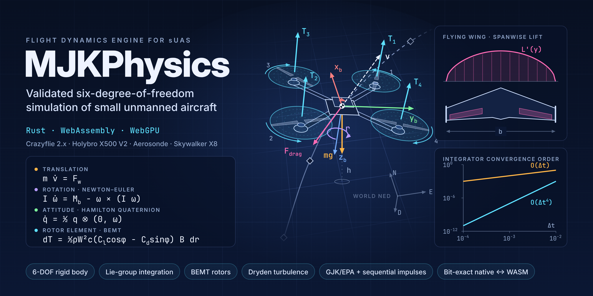
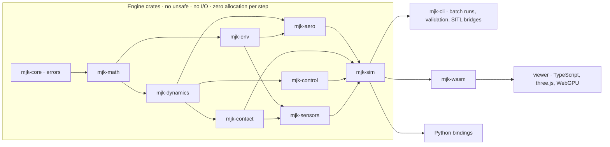

<p align="center">
  
</p>

<h1 align="center">MJKPhysics</h1>

<p align="center">
  <strong>A validated six-degree-of-freedom flight dynamics engine for small unmanned aircraft,<br>
  written in Rust and rendered in the browser with WebGPU.</strong>
</p>

<p align="center">
  <a href="https://github.com/MatthewK84/MJKPhysics/actions/workflows/ci.yml?query=branch%3Amain"></a>
  <a href="https://matthewk84.github.io/MJKPhysics/"></a>
  <a href="https://matthewk84.github.io/MJKPhysics/engineering-standards.html"></a>
  <a href="https://github.com/MatthewK84/MJKPhysics/issues/1"></a>
  
  
  <a href="#license"></a>
</p>

---

MJKPhysics is a flight simulator built the way an aerospace engineer would want to audit it.
Every force and moment comes from a model that is derived in the docs, cited to its source, tested
against a closed-form answer or published data, and stated with the range where it is valid. The same
engine runs natively for batch analysis and in the browser, through WebAssembly, behind a renderer
aiming for modern game-engine quality: physically based lighting, real terrain, and effects such as
rotor blur and downwash that are computed from the simulated physics rather than faked.

It targets four small unmanned aircraft with public, well-documented data: two quadrotors and two
fixed-wing aircraft.

> [!NOTE]
> **Status: pre-alpha.** [M0 · Foundation](https://github.com/MatthewK84/MJKPhysics/milestone/1) is
> complete: workspace and layering, CI enforcing the
> [engineering standards](https://matthewk84.github.io/MJKPhysics/engineering-standards.html),
> the engineering book, and the error and configuration model.
> [M1 · Core dynamics](https://github.com/MatthewK84/MJKPhysics/milestone/2) is complete:
> frame-typed math, the SO(3) maps, the rigid-body equations of motion, the integrators
> (including the Lie-group method), the fixed-step world loop, determinism and replay, gravity
> and the standard atmosphere, the analytic validation suite, and the `mjk` command-line tool.
> [M2 · Multirotor](https://github.com/MatthewK84/MJKPhysics/milestone/3) is under way: the
> airframe format, with a unit and a source on every number, and the brushless motor and ESC
> model are done, and the battery model is next.
> The banner above is a concept illustration generated from code in [`assets/readme/`](assets/readme/):
> a true perspective projection whose frames, vectors and rotor spin directions follow the project's
> conventions. Screenshots from the engine will replace it once the renderer milestone lands.

## Contents

- [Documentation](#documentation)
- [Why this exists](#why-this-exists)
- [Design principles](#design-principles)
- [What is modeled](#what-is-modeled)
- [Airframes](#airframes)
- [Conventions](#conventions)
- [How correctness is shown](#how-correctness-is-shown)
- [Architecture](#architecture)
- [Rendering](#rendering)
- [Roadmap](#roadmap)
- [Getting started](#getting-started)
- [Contributing](#contributing)
- [References](#references)
- [Acknowledgments and trademarks](#acknowledgments-and-trademarks)
- [License](#license)

## Documentation

The engineering book is published at **<https://matthewk84.github.io/MJKPhysics/>**, with its
source in [`docs/`](docs/). It covers conventions and notation, architecture, decision records
for the major design choices, and, as they land, one page per physical model with its equations,
assumptions, validity range, sources and validation. Equations have stable IDs, such as
`CONV-9`, that code comments cite and CI checks.

## Why this exists

Game physics engines look superb but treat aircraft as boxes with a thrust force. Engineering
simulators are rigorous but rarely pleasant to watch, and their models are often hard to trace back
to a source. MJKPhysics sits between the two:

- **Rigorous enough to check.** Rotor thrust comes from blade element momentum theory, not
  `T = k·ω²`. Attitude is integrated on the rotation group, not by renormalizing a drifting
  quaternion. Turbulence has the spectrum the military specification says it should.
- **Good enough to watch.** The renderer, inputs and camera system are built so that flying a
  Crazyflie through a gust or watching an X8 flare on landing is worth doing for its own sake.
- **Honest about its limits.** Every model page lists where the model stops being valid, and the
  engine flags when a run leaves that range.

## Design principles

1. **The physics is derived, not borrowed.** Engine crates use no third-party physics, math or
   collision libraries. Quaternions, the SO(3) maps, the contact solver and GJK/EPA are written here
   and tested here.
2. **Every model states its assumptions, its validity range and its sources.** Parameters carry a
   unit, a citation and an uncertainty. Leaving a validity range is reported, never silently clamped.
3. **Fidelity is a ladder.** Each subsystem offers selectable tiers, from `T = k·ω²` up to BEMT with
   blade flapping, so the effect of each modeling choice can be shown side by side.
4. **Deterministic.** The same scenario, inputs and seed produce an identical state hash on every
   run, natively and in WebAssembly. Recorded flights replay bit for bit.
5. **Rendering never feeds back into physics.** The viewer reads snapshots; nothing it does can
   change a simulated result.
6. **Checked by tools, not trust.** The code follows NASA/JPL's Power of Ten rules, adapted to
   Rust and TypeScript, and CI enforces each one it can: no recursion (found in the compiled call
   graph), bounded loops, short functions, no `unsafe`, no panicking shortcuts. The tests are
   tested in turn: every change is mutation-tested, and a surviving mutant fails the build.

## What is modeled

| Subsystem | Model | Fidelity tiers | Roadmap |
|---|---|---|---|
| Rigid body | Newton–Euler with full inertia tensor and gyroscopic coupling; frame-typed vectors so body and world quantities cannot be mixed | — | [#8](https://github.com/MatthewK84/MJKPhysics/issues/8), [#10](https://github.com/MatthewK84/MJKPhysics/issues/10) |
| Integration | Explicit and semi-implicit Euler, RK4, and Runge–Kutta–Munthe-Kaas on SO(3) | 4 integrators, compared for drift and order | [#11](https://github.com/MatthewK84/MJKPhysics/issues/11), [#12](https://github.com/MatthewK84/MJKPhysics/issues/12) |
| Atmosphere and gravity | U.S. Standard Atmosphere 1976, Sutherland viscosity, WGS-84 normal gravity | constant or altitude-dependent | [#15](https://github.com/MatthewK84/MJKPhysics/issues/15) |
| Rotors | Blade element momentum theory with Prandtl losses; oblique-flow inflow, H-force and first-harmonic flapping; optional Pitt–Peters dynamic inflow; ground effect | `k·ω²` → `C_T(J)` tables → axial BEMT → BEMT + forward flight | [#21](https://github.com/MatthewK84/MJKPhysics/issues/21)–[#24](https://github.com/MatthewK84/MJKPhysics/issues/24) |
| Electric propulsion | BLDC electrical model, ESC latency and slew, Thevenin battery with voltage sag | first-order lag or full electrical | [#19](https://github.com/MatthewK84/MJKPhysics/issues/19), [#20](https://github.com/MatthewK84/MJKPhysics/issues/20) |
| Fixed-wing aerodynamics | Stability-axis coefficient model with nonlinear lift through stall; trim, linearization and modal analysis (short period, phugoid, Dutch roll, roll, spiral) | linear derivatives or nonlinear stall blend | [#44](https://github.com/MatthewK84/MJKPhysics/issues/44), [#47](https://github.com/MatthewK84/MJKPhysics/issues/47), [#48](https://github.com/MatthewK84/MJKPhysics/issues/48) |
| Wind | Shear profiles, Dryden (MIL-F-8785C) and von Kármán (MIL-HDBK-1797) turbulence, 1 − cos gusts, evaluated per rotor and per surface | steady, turbulent, gust | [#53](https://github.com/MatthewK84/MJKPhysics/issues/53), [#54](https://github.com/MatthewK84/MJKPhysics/issues/54) |
| Contact and collision | GJK/EPA narrowphase, dynamic AABB tree, sequential-impulse solver with warm starting and Coulomb friction, joints, cable-suspended payloads, crashes | — | [#55](https://github.com/MatthewK84/MJKPhysics/issues/55)–[#61](https://github.com/MatthewK84/MJKPhysics/issues/61) |
| Control | Control allocation with priority desaturation; PX4-style cascaded controller; geometric SE(3) controller with differential-flatness feedforward; TECS and L1 guidance for fixed-wing | cascaded PID or geometric | [#25](https://github.com/MatthewK84/MJKPhysics/issues/25)–[#28](https://github.com/MatthewK84/MJKPhysics/issues/28), [#49](https://github.com/MatthewK84/MJKPhysics/issues/49) |
| Sensors | IMU with Allan-variance noise terms, GNSS, barometer, magnetometer (WMM), rangefinder, pitot | ideal or noisy | [#72](https://github.com/MatthewK84/MJKPhysics/issues/72), [#73](https://github.com/MatthewK84/MJKPhysics/issues/73) |
| Interoperability | ArduPilot JSON SITL and PX4 MAVLink lockstep bridges, Python bindings, MCAP logs | — | [#74](https://github.com/MatthewK84/MJKPhysics/issues/74)–[#79](https://github.com/MatthewK84/MJKPhysics/issues/79) |

## Airframes

Each airframe is a TOML file in which every parameter carries a unit, a source and, where known, an
uncertainty. A docs page is generated from each file, so the provenance of every number is visible.

| Airframe | Class | Why it is here | Primary sources | Roadmap |
|---|---|---|---|---|
| **Bitcraze Crazyflie 2.x** | Nano quadrotor | Open hardware with a published system-identification study | Förster (2015); Eschmann, Albani & Loianno (2024) | [#29](https://github.com/MatthewK84/MJKPhysics/issues/29) |
| **Holybro X500 V2** | 500 mm quadrotor | PX4's reference airframe; links the sim to PX4's Gazebo model and SITL | PX4 Gazebo `x500` model; Holybro specifications | [#30](https://github.com/MatthewK84/MJKPhysics/issues/30) |
| **Aerosonde** | Small fixed-wing | The standard textbook small-UAS model, with a public reference implementation to cross-check against | Beard & McLain (2012); BYU `mavsim_public` | [#50](https://github.com/MatthewK84/MJKPhysics/issues/50) |
| **Skywalker X8** | Flying wing | Wind-tunnel, CFD and flight-test-identified models published by NTNU | Gryte et al. (2018); Reinhardt et al. (2022); Løw-Hansen et al. (2025) | [#51](https://github.com/MatthewK84/MJKPhysics/issues/51) |

Airframes were chosen for the quality of their public data. Aircraft without published aerodynamic
or mass-property data are out of scope until such data exists.

## Conventions

Convention errors are the most common simulator bug, so they are fixed before any math is written.
The full specification, with equations, sign tables and the symbol table, is
[`docs/src/conventions.md`](docs/src/conventions.md). In short:

- **Frames:** world is local-level **NED** (flat earth); body is **FRD**; stability and wind axes
  follow Stevens, Lewis & Johnson. Conversion to the renderer's Y-up frame happens in exactly one place.
- **Attitude:** unit quaternion `q_wb`, **Hamilton** convention, scalar first, rotating body vectors
  into the world frame. Euler angles (3-2-1) are used for input and output only, never as state.
- **Units:** SI throughout, with unit suffixes in field names (`mass_kg`, `omega_rad_s`).
- **Multirotor layout:** PX4 quad-X motor numbering and spin directions.
- **Types enforce frames:** `Vec3<Body>` and `Vec3<World>` are different types, so adding a body
  vector to a world vector is a compile error.

## How correctness is shown

Results are checked at four levels, and the generated validation report shows the tolerance,
result and known limitations of each check ([#81](https://github.com/MatthewK84/MJKPhysics/issues/81)):

1. **Analytic solutions:** free fall, projectile with linear drag, torque-free precession, the
   intermediate-axis (Dzhanibekov) flip, bouncing and sliding contact, pendulum energy.
2. **Numerical properties:** measured convergence order for every integrator, energy and angular
   momentum drift, and unit-norm preservation on SO(3).
3. **Published data and reference implementations:** propeller performance against the UIUC
   Propeller Data Site, Crazyflie thrust maps against the published identification, Aerosonde trim
   and eigenvalues against BYU's reference code, X8 coefficients against the NTNU papers.
4. **Statistical checks:** turbulence power spectra against the Dryden PSD, and IMU noise recovered
   from Allan deviation plots.

The tests are checked too. Engine line coverage must stay at or above 90 %, and mutation testing
changes the code in small ways and fails CI if any change goes unnoticed by every test; no mutant
of the engine survives. The
[Engineering standards](https://matthewk84.github.io/MJKPhysics/engineering-standards.html) page
explains what that process found.

Every issue shares one definition of done, kept in the tracking issue
([#1](https://github.com/MatthewK84/MJKPhysics/issues/1)): lint-clean, no `unsafe` in engine crates,
no heap allocation in the step loop, a docs page with numbered equations, and at least one test
against an analytic result or published data.

## Architecture



Arrows point from a crate to the crates that build on it. The layering is enforced by a check over
`cargo metadata`, so an engine crate cannot accidentally depend on a front end.

- **Fixed-step core:** physics runs at a fixed 1 kHz with subsystems (control, sensors) at integer
  divisors. Real-time front ends use an accumulator and interpolate between states for display.
- **Determinism:** transcendental functions go through `libm`, random streams are seeded per
  subsystem, and CI requires a WebAssembly build to print the same state hashes as the native
  build, byte for byte ([Determinism and replay](https://matthewk84.github.io/MJKPhysics/determinism.html)).
- **In the browser:** the engine runs in a Web Worker and hands snapshots to the renderer as
  transferable buffers, so the demo can be hosted on GitHub Pages without cross-origin isolation.

## Rendering

The viewer aims for the look of a modern game engine while staying honest to the simulation:

- Linear HDR pipeline with a physical camera (shutter, aperture, ISO), physically based sun and sky,
  image-based lighting, and cascaded shadow maps.
- Procedural airframes generated from the same files that drive the physics, including propeller
  blades lofted from the BEMT chord and twist distributions.
- **Rotor blur computed, not faked:** when a rotor turns more than one blade spacing during the
  exposure, it is drawn as a disk whose opacity at each radius equals the blade coverage `N·c(r)/(2πr)`.
- Real-world terrain from public elevation models, vegetation that moves with the simulated wind,
  downwash dust driven by momentum-theory induced velocity, and rotor audio at the simulated
  blade-passing frequency.
- An engineering view that overlays thrust, drag, lift distribution and inflow straight from the
  physics snapshot.

## Roadmap

The full plan is 85 issues across nine milestones, tracked in
[#1](https://github.com/MatthewK84/MJKPhysics/issues/1). Each issue lists its scope, acceptance
criteria, references and dependencies.

| Milestone | Delivers | Issues |
|---|---|---|
| [M0 · Foundation](https://github.com/MatthewK84/MJKPhysics/milestone/1) | Workspace, lint policy, CI, conventions, docs site, config loading, engineering standards enforced in CI | 7 |
| [M1 · Core dynamics](https://github.com/MatthewK84/MJKPhysics/milestone/2) | Frame-typed math, rigid body, four integrators, deterministic loop, analytic validation | 10 |
| [M2 · Multirotor](https://github.com/MatthewK84/MJKPhysics/milestone/3) | Motor, ESC and battery; BEMT rotors with forward-flight effects; allocation; two controllers; Crazyflie and X500 | 14 |
| [M3 · Renderer foundation](https://github.com/MatthewK84/MJKPhysics/milestone/4) | WebAssembly build, browser viewer, lighting and shadows, rotor blur, piloting, HUD | 11 |
| [M4 · Fixed-wing](https://github.com/MatthewK84/MJKPhysics/milestone/5) | Aerodynamics through stall, trim and modal analysis, TECS/L1 autopilot, Aerosonde and X8 | 10 |
| [M5 · Environment, contact and collision](https://github.com/MatthewK84/MJKPhysics/milestone/6) | Turbulence, GJK/EPA, BVH, sequential impulses, slung payload, crashes | 9 |
| [M6 · Visual fidelity](https://github.com/MatthewK84/MJKPhysics/milestone/7) | Terrain, vegetation, physical atmosphere, post-processing, downwash, audio, replay | 10 |
| [M7 · Sensors, SITL and tooling](https://github.com/MatthewK84/MJKPhysics/milestone/8) | Sensor models, ArduPilot and PX4 SITL, fault injection, Monte Carlo, Python, MCAP logs | 8 |
| [M8 · Showcase and release](https://github.com/MatthewK84/MJKPhysics/milestone/9) | Validation report, benchmarks, live demo, v0.1.0 | 6 |

M3 is the first milestone where you can fly a validated quadrotor in the browser.

## Getting started

The rigid-body core is in place: you can run the validation studies, and record and replay the
reference scenario. Vehicles arrive with
[M2 · Multirotor](https://github.com/MatthewK84/MJKPhysics/milestone/3). You need
[rustup](https://rustup.rs); the toolchain, components and WebAssembly target are pinned in
`rust-toolchain.toml`.

```bash
git clone https://github.com/MatthewK84/MJKPhysics.git && cd MJKPhysics
```

```bash
rustup toolchain install
```

```bash
cargo build --workspace && cargo test --workspace
```

Record the reference scenario and replay it, to the bit
([Command-line tool](https://matthewk84.github.io/MJKPhysics/cli.html)):

```bash
cargo run -p mjk-cli --release -- run reference --log run.json
```

```bash
cargo run -p mjk-cli --release -- replay run.json
```

Check crate layering, equation citations and the Power of Ten rules:

```bash
cargo xtask layering && cargo xtask equations && cargo xtask standards
```

[CONTRIBUTING.md](CONTRIBUTING.md) lists the full set of checks CI runs, with the commands.

### Repository layout

```text
crates/
  mjk-core       engine error model, beneath every engine crate
  mjk-math       frame-tagged linear algebra, quaternions, SO(3)
  mjk-dynamics   rigid body, integrators, world loop, trim
  mjk-env        atmosphere, gravity, wind, turbulence
  mjk-aero       rotors, propulsion, fixed-wing aerodynamics
  mjk-contact    collision detection, contact and joint solver
  mjk-control    allocation, controllers, guidance
  mjk-sensors    IMU, GNSS, barometer, magnetometer, range, airspeed
  mjk-sim        world composition, airframes, scenarios
  mjk-cli        the `mjk` command-line tool
  mjk-wasm       WebAssembly bindings for the browser viewer
  mjk-alloc-counter  counting allocator for the zero-allocation test (test support only)
xtask/           repository automation (`cargo xtask layering | equations | standards`)
docs/            the engineering book (mdBook)
viewer/          browser viewer (TypeScript), and the lint policy shared by all scripts
assets/readme/   source and render script for the README illustration
```

## Contributing

Issues are written to be picked up independently: each one has a scope, checkbox acceptance
criteria, references and links to the issues it depends on. Labels group them by area
(`area:aero`, `area:contact`, `area:render`, …) and by kind (`kind:validation`, `kind:infra`).
Before starting, read the principles and definition of done in
[#1](https://github.com/MatthewK84/MJKPhysics/issues/1), and
[CONTRIBUTING.md](CONTRIBUTING.md) for the workflow, the checks to run locally and how CI enforces
each coding rule.

## References

Core texts and papers the models are built on; each issue and model page cites its own sources.

- B. L. Stevens, F. L. Lewis, E. N. Johnson, *Aircraft Control and Simulation*, 3rd ed., Wiley, 2015.
- R. W. Beard, T. W. McLain, *Small Unmanned Aircraft: Theory and Practice*, Princeton University Press, 2012.
- J. G. Leishman, *Principles of Helicopter Aerodynamics*, 2nd ed., Cambridge University Press, 2006.
- R. Mahony, V. Kumar, P. Corke, "Multirotor aerial vehicles: modeling, estimation, and control of quadrotor," *IEEE Robotics & Automation Magazine*, 2012.
- J. Solà, "Quaternion kinematics for the error-state Kalman filter," arXiv:1711.02508, 2017.
- H. Munthe-Kaas, "Runge–Kutta methods on Lie groups," *BIT Numerical Mathematics*, 1998.
- T. Lee, M. Leok, N. H. McClamroch, "Geometric tracking control of a quadrotor UAV on SE(3)," IEEE CDC, 2010.
- E. Catto, "Iterative Dynamics with Temporal Coherence," Game Developers Conference, 2005.
- MIL-F-8785C, *Flying Qualities of Piloted Airplanes*, 1980.
- S. Hillaire, "A scalable and production ready sky and atmosphere rendering technique," *Computer Graphics Forum*, 2020.
- J. Förster, "System Identification of the Crazyflie 2.0 Nano Quadrocopter," B.Sc. thesis, ETH Zurich, 2015.
- K. Gryte et al., "Aerodynamic modeling of the Skywalker X8 fixed-wing unmanned aerial vehicle," ICUAS, 2018.

## Acknowledgments and trademarks

The airframe models depend on data published by Bitcraze and ETH Zurich (Crazyflie), the PX4
project and Holybro (X500), the BYU MAGICC Lab (Aerosonde reference code), NTNU (Skywalker X8) and
the UIUC Propeller Data Site. Thank you for making it public.

Crazyflie is a trademark of Bitcraze AB. Holybro, PX4, ArduPilot, Aerosonde and Skywalker are
trademarks of their respective owners. Names are used only to identify the aircraft and software
being modeled; this project is not affiliated with or endorsed by any of them, and no
manufacturer artwork or logos are used.

## License

Licensed under either of

- Apache License, Version 2.0 ([LICENSE-APACHE](LICENSE-APACHE))
- MIT license ([LICENSE-MIT](LICENSE-MIT))

at your option.

Unless you explicitly state otherwise, any contribution intentionally submitted for inclusion in
the work by you, as defined in the Apache-2.0 license, shall be dual licensed as above, without any
additional terms or conditions.
